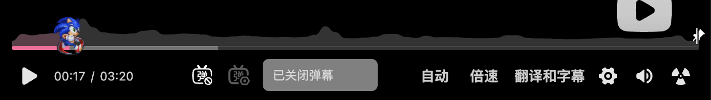
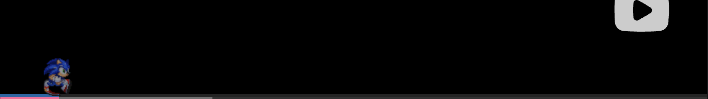

# YouTube–Bilibili Drag Icon Script

Three separate adapters are included. They are not interchangeable.

| Target | Files | Behavior |
| --- | --- | --- |
| YouTube website | `browser/youtube-drag-icon.css` | Decorates the existing seek handle through a site-specific Stylus style. |
| Bilibili website | `browser/bilibili-drag-icon.css`, optionally `browser/bilibili-idle-progress.user.js` | CSS decorates the native handle; the Tampermonkey userscript shows a passive bottom progress indicator while controls are hidden. |
| Bilibili macOS application | `macos/SonicBilibili.mjs` | A local Node.js launcher adds a GIF character to the native progress track or idle bottom track. |

## Browser CSS

In Stylus, create a style restricted to `youtube.com` or `bilibili.com` and paste the matching CSS file. Do not apply it to all sites. Disable the style to restore the default appearance.

The GIF supplies the running animation; the existing seek handle supplies position. GIF animation may continue while playback is paused. These minimal CSS adapters were packaged here; they have not been verified against the current live player layouts. A platform update can require different selectors.

The default GIF is an external reference from the earlier learning example. Replace `--progress-icon` with your own authorized artwork. Third-party artwork is not relicensed by this repository.

## Bilibili idle userscript

Install `browser/bilibili-idle-progress.user.js` in Tampermonkey. It does not require Stylus to draw its own passive idle bar. It does not replace native drag/seek controls. The native-handle CSS is separate.

## Bilibili Mac

Requires macOS, Node.js 22+, and the official Bilibili client in the documented location. Read `macos/README.md` for the full sequence. From `macos/`:

```sh
node SonicBilibili.mjs character /path/to/character.gif
# Quit Bilibili normally before starting the themed session.
node SonicBilibili.mjs start
node SonicBilibili.mjs status
node SonicBilibili.mjs restore
```

The custom GIF is stored locally. The script uses a temporary localhost Electron debugging connection; a full application exit closes that session. Restoration can interrupt playback. No Windows support is claimed.

## Recorded demos

These are existing Bilibili Mac screenshots from October 27, 2026, not new YouTube compatibility tests.





The images demonstrate the displayed character and two control states. They do not establish support for all fullscreen, mini-player, or future client versions.
