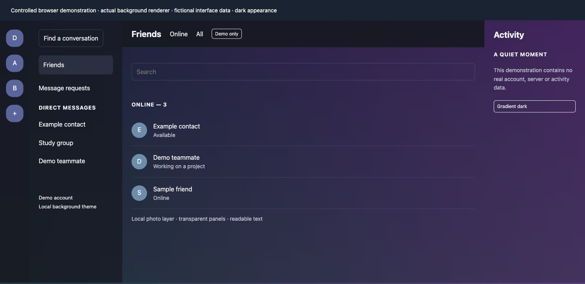
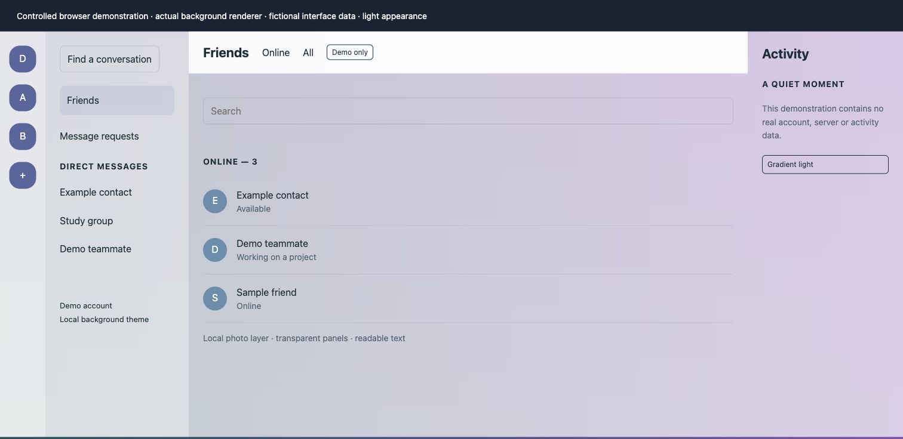

# Discord Background Script

Experimental macOS background/theme adapter with a native launcher. It supports local photos, validated DreamSkin-compatible theme packs, saved themes, appearance controls, and restoration. Source is in `Discord-Photo-Mac/`.

## Start here

Requires macOS, Node.js 22+, Python 3.9+, and the official Discord application. No npm dependencies are required.

Read [the full guide](Discord-Photo-Mac/README.md) and [launcher instructions](Discord-Photo-Mac/LAUNCHER.md). From `Discord-Photo-Mac/`:

```sh
node DiscordPhoto.mjs import /path/to/your-photo.png
# Quit Discord normally before starting a themed session.
node DiscordPhoto.mjs start
node DiscordPhoto.mjs verify
node DiscordPhoto.mjs restore
```

For a clickable launcher, run the included `Install Discord Themes.command` on your own Mac. It creates a separate launcher in your personal Applications folder; Node and Python are separate prerequisites.

Importing a photo saves it locally. It does not upload the photo to Discord. The adapter temporarily applies CSS through a localhost debugging connection, without rewriting the installed application bundle. Restarting interrupts calls or unsaved work; follow the restoration instructions.

## Demo images

The two published screenshots are controlled browser fixtures executing this project's renderer with a neutral bundled gradient. They use fictional names and no Discord account data. They are not screenshots of a new live-client test. Historical real-client testing and its limitations are documented in [TEST-REPORT.md](Discord-Photo-Mac/TEST-REPORT.md).





To regenerate the local fixture HTML: `node demos/build-demo.mjs`. Open the generated pages through a local HTTP server.

## Checks

```sh
node --test Discord-Photo-Mac/tests/launcher.test.mjs
python3 Discord-Photo-Mac/tests/test_theme_packs.py
```

Unreviewed local sessions, downloaded artwork, private photos, and original account screenshots are not included. The upstream Safe CSS validator and its MIT license/attribution are preserved in the bundled NOTICE and vendor directory. This is not an official Discord or DreamSkin client; client changes can affect compatibility.
